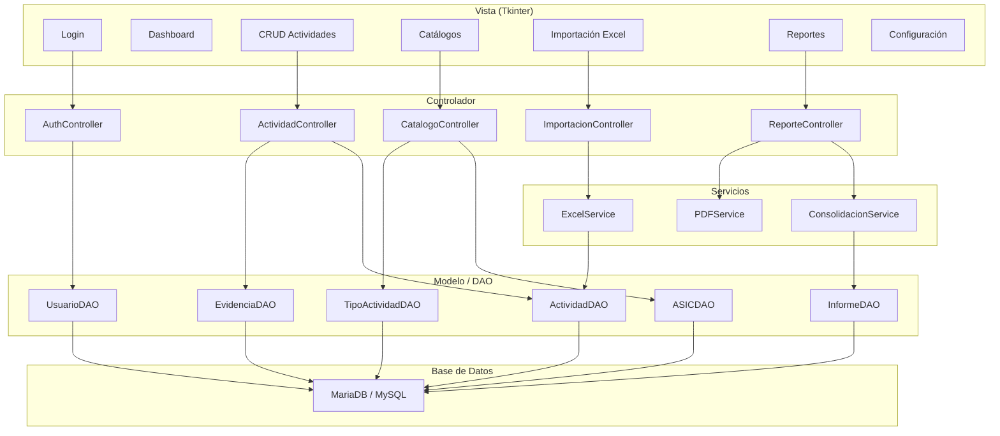
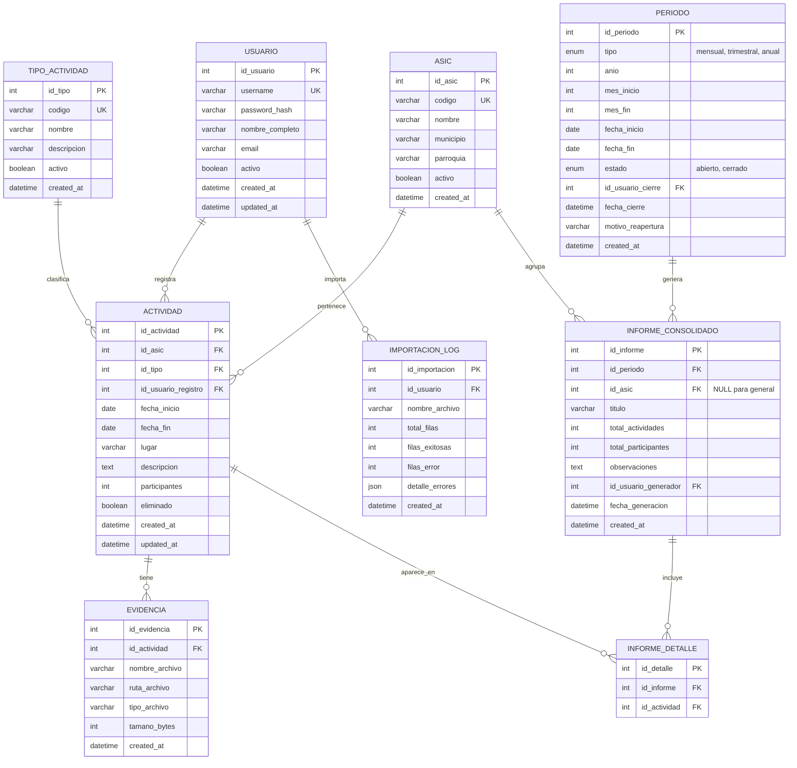

# 📋 Plan de Proyecto — Sistema DPPPS Consolidación de Informes

## 1. Análisis de la Situación Actual

### Problema Identificado

La **DPPPS (División para la Promoción de la Participación Popular en Salud)** de la Corporación de Salud del Estado Táchira gestiona múltiples actividades mensuales a través de sus **ASIC** (Áreas de Salud Integral Comunitaria). Actualmente:

| Aspecto                       | Situación Actual                 | Impacto                                             |
| ----------------------------- | -------------------------------- | --------------------------------------------------- |
| Registro de datos             | Libretas físicas                 | Pérdida de información, deterioro, difícil búsqueda |
| Informes mensuales            | Recopilación manual              | Demoras de días/semanas, errores de transcripción   |
| Informes trimestrales/anuales | Consolidación manual de libretas | Inconsistencias, datos incompletos                  |
| Evidencias                    | Archivos sueltos sin vinculación | Difícil demostrar actividades realizadas            |

### Consecuencias directas

- **Retrasos** en la entrega de informes a entes superiores.
- **Errores** en cifras consolidadas (participantes, actividades).
- **Imposibilidad** de generar comparativos rápidos entre períodos.
- **Riesgo de pérdida** de información por deterioro de libretas.

---

## 2. Objetivo General

Desarrollar un sistema de escritorio que **digitalice, consolide y reporte** las actividades realizadas por las ASIC, eliminando la dependencia de registros físicos y automatizando la generación de informes gerenciales periódicos.

### Objetivos Específicos

1. Permitir el registro de actividades de forma **manual** (formulario) y **masiva** (importación Excel).
2. **Consolidar automáticamente** informes mensuales, trimestrales y anuales.
3. **Exportar reportes** en formatos PDF y Excel.
4. Soportar uso en **red local (LAN)** además de modo local.

---

## 3. Arquitectura del Sistema (MVC)



---

## 4. Estructura de Carpetas — ✅ FINALIZADO

```
Proyecto-trayecto-2/
├── main.py                      # Punto de entrada
├── config/
│   ├── __init__.py
│   ├── settings.py              # Configuración general (modo local/LAN)
│   └── database.py              # Parámetros de conexión BD
├── db/
│   ├── __init__.py
│   ├── connection.py            # Pool de conexiones MariaDB
│   ├── migrations/
│   │   ├── 001_create_tables.sql
│   │   └── 002_seed_data.sql
│   └── schema.sql               # Script completo del esquema
├── models/
│   ├── __init__.py
│   ├── usuario.py
│   ├── asic.py
│   ├── tipo_actividad.py
│   ├── actividad.py
│   ├── evidencia.py
│   ├── periodo.py
│   └── informe.py
├── controllers/
│   ├── __init__.py
│   ├── auth_controller.py
│   ├── actividad_controller.py
│   ├── catalogo_controller.py
│   ├── importacion_controller.py
│   └── reporte_controller.py
├── views/
│   ├── __init__.py
│   ├── login_view.py
│   ├── main_view.py             # Ventana principal con navegación
│   ├── dashboard_view.py
│   ├── actividad_form_view.py
│   ├── actividad_list_view.py
│   ├── catalogo_view.py
│   ├── importacion_view.py
│   ├── reporte_view.py
│   └── components/              # Widgets reutilizables
│       ├── __init__.py
│       ├── data_table.py
│       ├── date_picker.py
│       └── file_upload.py
├── services/
│   ├── __init__.py
│   ├── excel_service.py         # Importación/Exportación Excel
│   ├── pdf_service.py           # Generación de PDFs
│   └── consolidacion_service.py # Lógica de consolidación
├── utils/
│   ├── __init__.py
│   ├── validators.py            # Validaciones de datos
│   ├── helpers.py               # Funciones auxiliares
│   └── constants.py             # Constantes del sistema
├── assets/
│   ├── icons/
│   └── templates/
│       └── plantilla_importacion.xlsx
├── uploads/                     # Evidencias subidas
├── exports/                     # Reportes generados
├── docs/
│   ├── manual_usuario.md
│   ├── manual_tecnico.md
│   └── der/                     # Diagrama Entidad-Relación
├── tests/
│   ├── __init__.py
│   ├── test_actividad.py
│   └── test_consolidacion.py
├── requirements.txt
└── README.md
```

---

## 5. Diseño de Base de Datos (DER Normalizado) — ✅ FINALIZADO (schema.sql + setup.py creados)

### 5.1 Diagrama Entidad-Relación



### 5.2 Diccionario de Datos — Tablas Principales

| Tabla                 | Propósito                             | Registros estimados |
| --------------------- | ------------------------------------- | ------------------- |
| `usuario`             | Credenciales y roles del sistema      | 10-30               |
| `asic`                | Catálogo de Áreas de Salud            | 15-40               |
| `tipo_actividad`      | Catálogo de tipos de actividad        | 10-30               |
| `actividad`           | Registro principal de cada actividad  | Miles/año           |
| `evidencia`           | Archivos/fotos asociados              | Miles/año           |
| `periodo`             | Períodos de consolidación             | ~16/año             |
| `informe_consolidado` | Cabecera de informes generados        | Decenas/año         |
| `informe_detalle`     | Actividades incluidas en cada informe | Miles/año           |
| `importacion_log`     | Registro de importaciones Excel       | Decenas/año         |

### 5.3 Regla de Duplicidad

Una actividad se considera **duplicada** si coinciden los 4 campos:

- `id_asic` + `id_tipo` + `fecha_inicio` + `descripcion` (primeros 100 caracteres normalizados a minúscula y sin espacios extra)

---

## 6. Reglas de Negocio

### 6.1 Gestión de Actividades

- Todas las actividades son **editables** y **eliminables** (soft delete).
- Al registrar o importar, la actividad queda disponible inmediatamente para consolidación y reportes.
- **Soft delete**: las actividades no se borran definitivamente, se marcan como eliminadas.

### 6.2 Cierre de Período

- Solo el **admin** puede cerrar/reabrir períodos.
- Al **cerrar**: no se aceptan nuevas actividades ni modificaciones en ese rango de fechas.
- Al **reabrir**: se exige motivo.

### 6.3 Rol Único: Administrador

El sistema maneja un único rol **admin** con acceso total:

| Permiso                           | Admin |
| --------------------------------- | ----- |
| Gestionar catálogos (ASIC, tipos) | ✅    |
| Registrar actividades             | ✅    |
| Editar / Eliminar actividades     | ✅    |
| Importar Excel                    | ✅    |
| Generar reportes                  | ✅    |
| Exportar PDF/Excel                | ✅    |
| Cerrar/Reabrir períodos           | ✅    |

---

## 7. Tecnologías y Dependencias — ✅ FINALIZADO (requirements.txt + dependencias instaladas)

### requirements.txt

```
# Base de datos
mysql-connector-python>=8.0.0
# O alternativa: PyMySQL>=1.0.0

# Excel
openpyxl>=3.1.0

# PDF
reportlab>=4.0.0
# O alternativa: fpdf2>=2.7.0

# Utilidades
bcrypt>=4.0.0          # Hash de contraseñas
Pillow>=10.0.0         # Manejo de imágenes/evidencias
tkcalendar>=1.6.1      # Selector de fechas en Tkinter

# Opcionales
python-dotenv>=1.0.0   # Variables de entorno
```

---

## 8. Configuración Local vs LAN

```python
# config/settings.py — Ejemplo de configuración

MODO = "local"  # Opciones: "local" | "lan"

DATABASE = {
    "local": {
        "host": "localhost",
        "port": 3306,
        "user": "root",
        "password": "",
        "database": "dppps_informes"
    },
    "lan": {
        "host": "192.168.1.100",  # IP del servidor en LAN
        "port": 3306,
        "user": "dppps_app",
        "password": "contraseña_segura",
        "database": "dppps_informes"
    }
}

# Rutas
UPLOADS_DIR = "uploads/"
EXPORTS_DIR = "exports/"
TEMPLATE_PATH = "assets/templates/plantilla_importacion.xlsx"

# Seguridad
SESSION_TIMEOUT_MINUTES = 30
MAX_FILE_SIZE_MB = 10
ALLOWED_EXTENSIONS = [".jpg", ".jpeg", ".png", ".pdf", ".docx"]
```

---

## 9. Casos de Uso Principales

### CU-01: Registrar Actividad Manualmente

- **Actor**: Admin
- **Flujo**: Login → Actividades → Nueva → Llenar formulario → Adjuntar evidencias → Guardar
- **Validaciones**: Fecha inicio ≤ fin, participantes ≥ 0, campos obligatorios, verificar duplicidad

### CU-02: Importar Actividades desde Excel

- **Actor**: Admin
- **Flujo**: Login → Importación → Seleccionar archivo → Pre-validación → Revisar errores → Confirmar importación
- **Validaciones**: Formato de plantilla, datos por fila, duplicados

### CU-03: Generar Informe Consolidado

- **Actor**: Admin
- **Flujo**: Login → Reportes → Seleccionar período → Seleccionar ASIC (o todas) → Generar → Previsualizar → Exportar PDF/Excel

---

## 10. Plantilla Excel de Importación

La plantilla oficial tendrá las siguientes columnas:

| Columna           | Tipo   | Obligatorio | Ejemplo                             |
| ----------------- | ------ | ----------- | ----------------------------------- |
| A: Código ASIC    | Texto  | ✅          | "ASIC-01"                           |
| B: Tipo Actividad | Texto  | ✅          | "Jornada de Vacunación"             |
| C: Fecha Inicio   | Fecha  | ✅          | 15/03/2026                          |
| D: Fecha Fin      | Fecha  | ✅          | 15/03/2026                          |
| E: Lugar          | Texto  | ❌          | "CDI La Concordia"                  |
| F: Descripción    | Texto  | ✅          | "Jornada de vacunación infantil..." |
| G: Participantes  | Número | ✅          | 150                                 |

> [!NOTE]
> Las actividades importadas quedan disponibles inmediatamente para consolidación y reportes.

---

## 11. Métricas del Dashboard

El dashboard mostrará:

- **Total actividades** del mes actual.
- **Total participantes** del mes.
- **Últimas 5 actividades** registradas.
- **Períodos abiertos/cerrados**.
- **Gráfico comparativo** actividades por ASIC (mes actual).

---

## 12. Próximos Pasos

Una vez aprobada esta planificación, comenzaremos con:

1. **Crear la estructura de carpetas** del proyecto MVC.
2. **Escribir el script SQL** completo del esquema de base de datos.
3. **Implementar la conexión a BD** y configuración local/LAN.
4. **Construir el punto de entrada** (`main.py`) con la ventana principal.

> [!TIP]
> Recomiendo avanzar fase por fase, probando cada entregable antes de pasar a la siguiente. Esto permite detectar problemas tempranamente.

---

_Documento generado el 17/05/2026 — Versión 1.0_

---

## 📌 Registro de Avances

| Archivo / Módulo                                 | Estado        |
| ------------------------------------------------ | ------------- |
| Estructura de carpetas MVC                       | ✅ FINALIZADO |
| `config/settings.py`                             | ✅ FINALIZADO |
| `db/connection.py`                               | ✅ FINALIZADO |
| `db/schema.sql`                                  | ✅ FINALIZADO |
| `db/setup.py`                                    | ✅ FINALIZADO |
| `models/usuario.py` (UsuarioDAO)                 | ✅ FINALIZADO |
| `controllers/auth_controller.py`                 | ✅ FINALIZADO |
| `views/login_view.py`                            | ✅ FINALIZADO |
| `views/main_view.py`                             | ✅ FINALIZADO |
| `main.py`                                        | ✅ FINALIZADO |
| `requirements.txt` + dependencias                | ✅ FINALIZADO |
| `models/asic.py` (ASICDAO)                       | ✅ FINALIZADO |
| `models/tipo_actividad.py`                       | ✅ FINALIZADO |
| `models/actividad.py` (ActividadDAO)             | ✅ FINALIZADO |
| `controllers/catalogo_controller.py`             | ✅ FINALIZADO |
| `controllers/actividad_controller.py`            | ✅ FINALIZADO |
| `views/catalogo_view.py`                         | ✅ FINALIZADO |
| `views/actividad_view.py` (Formulario y Listado) | ✅ FINALIZADO |
| (Consolidado en actividad_view.py)               | ✅ FINALIZADO |
| `models/evidencia.py` + FileUpload               | ✅ FINALIZADO |
| `services/excel_service.py` (importar)           | ✅ FINALIZADO |
| `assets/templates/plantilla_importacion.xlsx`    | ✅ FINALIZADO |
| `views/importacion_view.py`                      | ✅ FINALIZADO |
| `services/consolidacion_service.py`              | ✅ FINALIZADO |
| `services/pdf_service.py`                        | ✅ FINALIZADO |
| `models/informe.py` (InformeDAO + PeriodoDAO)    | ✅ FINALIZADO |
| `views/reporte_view.py`                          | ✅ FINALIZADO |
| `views/dashboard_view.py` (completo)             | ✅ FINALIZADO |
